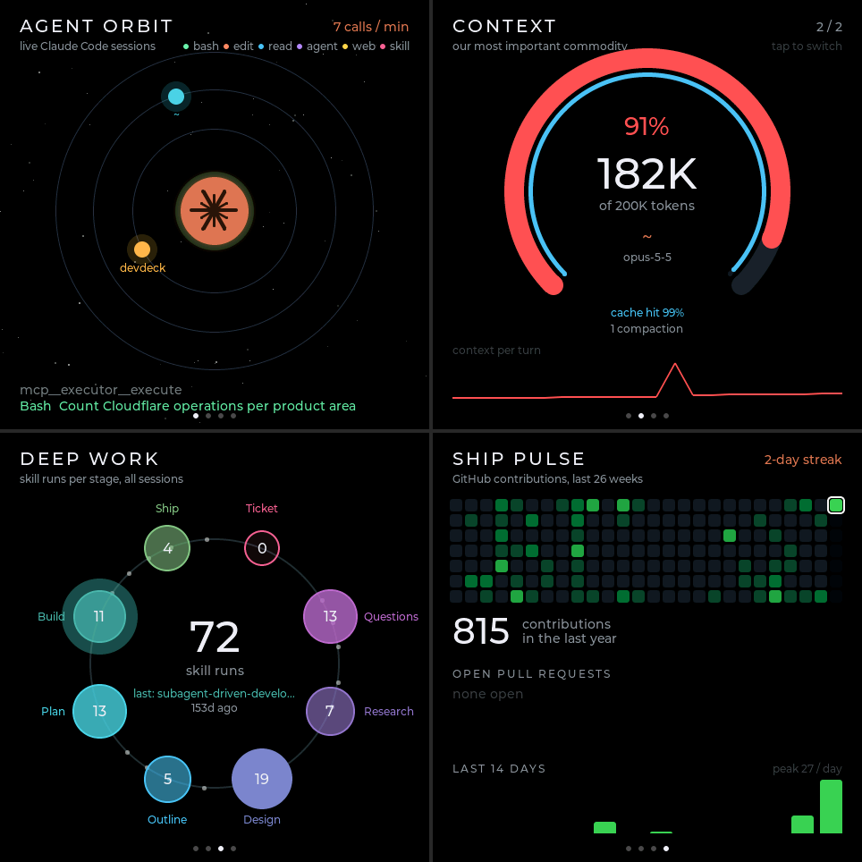
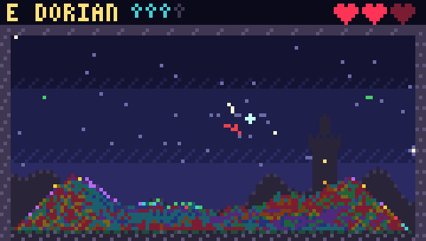
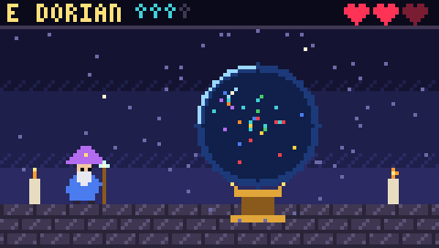

# esp32-demos

Demos for the Waveshare ESP32-C6-Touch-AMOLED-2.16, a 480×480 AMOLED touch board.

**devdeck** turns the board into a live dashboard of your dev process. The laptop sends data over USB to four screens:
- **Agent Orbit:** live Claude Code sessions and their tool calls
- **Context:** context-window usage for each live session
- **Deep Work:** your deep-work pipeline stages
- **Ship Pulse:** GitHub contributions and open PRs



The same firmware also carries a **launcher** and four more apps. Pick one on the home screen and the board reboots straight into it. Press **BOOT** to come back home.
- **Living Painting:** a reaction-diffusion painting that grows slowly; taps and your commits seed new blooms.
- **Sound Lens:** a live spectrogram waterfall from the on-board mics, with a chromatic tuner.
- **Signal Field:** every Wi-Fi, Bluetooth and Zigbee/Thread transmitter nearby, drawn as glowing orbs.
- **Ghost Sense:** motion sensing from Wi-Fi channel state, drawn as ridgelines. On a quiet network it needs to join and ping your router: stop the bridge and run `tools/deck.py wifi` once to save the credentials on the board.

You can also switch from the laptop with `tools/deck.py app lens` (ids: `home devdeck painting lens field ghost`).

To build and flash, load ESP-IDF 6.1 (`get_idf`), then:

```bash
cd firmware/devdeck && idf.py build && idf.py -p /dev/cu.usbmodem101 flash
```

If you built before the launcher landed, delete `firmware/devdeck/sdkconfig` once first, so the new radio settings in `sdkconfig.defaults` take effect.

To feed it live data, set up the tools once:

```bash
cd tools && python3 -m venv .venv && .venv/bin/pip install -r requirements.txt
```

Then start the bridge, and stop it before flashing:

```bash
tools/.venv/bin/python tools/deck.py bridge
```

See **[HANDOFF.md](HANDOFF.md)** for the hardware, architecture, wire protocol, status, decisions and known issues.

## Spellsong (M5StickS3)

A second board, the M5StickS3, runs **Spellsong**: generative NES-style chiptune in fantasy modes, with pixel-art scenes (a mana-sand hourglass and a wizard's scrying orb). It never plays out of key. Tilt, motion and shakes shape the melody, nearby Wi-Fi seeds the "realm", and a low battery slows the tempo. Scry mode listens to music in the room and adopts its key and tempo. See [firmware/spellsong](firmware/spellsong/README.md).

 
